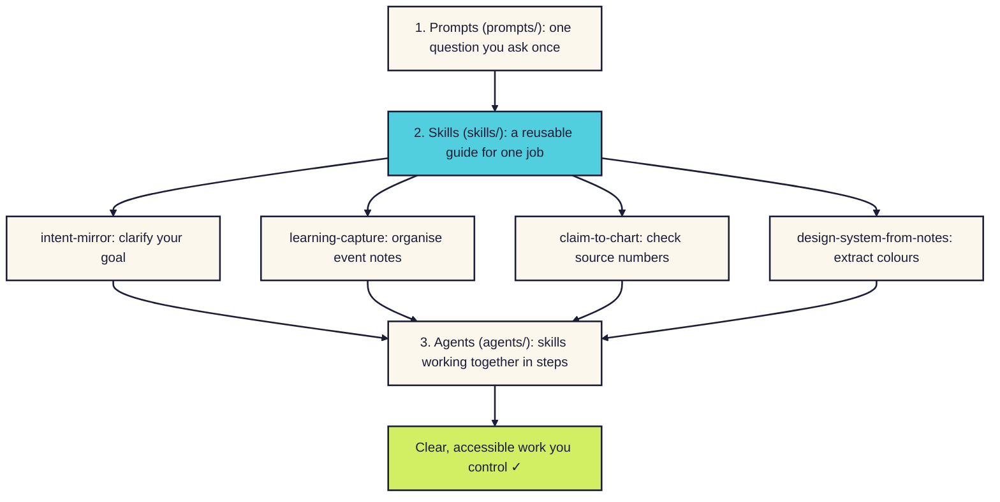

# ToolShed

Plain-English AI skills, prompts, and agents for people starting out. Built to be accessible, inclusive, and easy to get started with.

## New here?

Welcome to ToolShed. Everything here is made for people getting started with AI and skills, not only established professionals. Here are three clear paths to start:

1. **Copy a skill:** Head to [`skills/`](skills/) to find focused tools ready to use today. Copy one file into Claude, ChatGPT, or Google Gemini and start chatting.
2. **Read the stories:** Visit [`notes/`](notes/) to see why each skill was made, how it was tested, and what I learned along the way.
3. **Learn how a repo works:** Read our plain-English [GLOSSARY.md](GLOSSARY.md) to learn repo words with everyday pictures. Then see [How to add a skill](skills/how-to-add-a-skill.md) for quick setup steps.

Need help or want to suggest an idea? Read [CONTRIBUTING.md](CONTRIBUTING.md) to ask questions without needing Git commands.

## Why these skills exist

The skills in this shed are not trying to be flashy. Everything I publish here is written to be more accessible and inclusive. Each skill uses plain English, clear diagrams, and honest examples so you can get started with the practice of using AI skills without overwhelm.

You stay in control at every turn. Each tool suggests, and you make every final decision.

## How prompts, skills, and agents fit together

**In words:** a **prompt** is a single question you type once. When you want the AI to handle that job the same way every time, a prompt ladders into a **skill**. When several skills work together across a larger workflow, a skill ladders into an **agent**. Every step leads to clear, accessible work you control.

## Skills in the shed so far

Each skill in [`skills/`](skills/) does one focused job well. You can copy one into any AI chat app, like Claude, ChatGPT, or Gemini, with zero special setup:

- **[intent-mirror](skills/intent-mirror/):** Plays back your messy thoughts in under 200 words so you can check your goal before the AI starts building.
- **[learning-capture](skills/learning-capture/):** Turns event photos, slides, and voice notes into a tidy report, a concept map, and an action list.
- **[claim-to-chart](skills/claim-to-chart/):** Checks where a statistic came from and draws a clear bar chart with high-contrast colours.
- **[design-system-from-notes](skills/design-system-from-notes/):** Pulls colours and fonts from a slide or photo into a one-page token sheet you can reuse.

## What's in the shed

| Folder | What's in it |
|---|---|
| [`skills/`](skills/) | Skills: reusable instruction guides you can load into any AI chat app |
| [`notes/`](notes/) | Companion stories: why each skill was built, how it was tested, and lessons learned |
| [`prompts/`](prompts/) | Prompts: single-use questions you can copy and paste into any AI tool |
| [`agents/`](agents/) | Agents: multi-step role setups where skills work together with human checkpoints |

## Using anything here

Everything here is plain markdown. That means it works with any AI chat app that accepts written instructions.

To get started with a skill, read [How to add a skill](skills/how-to-add-a-skill.md) or visit [`skills/`](skills/). If you want to see why each skill was made, check the companion stories in [`notes/`](notes/). You can also check our [GLOSSARY.md](GLOSSARY.md), [CONTRIBUTING.md](CONTRIBUTING.md), and [CHANGELOG.md](CHANGELOG.md).
