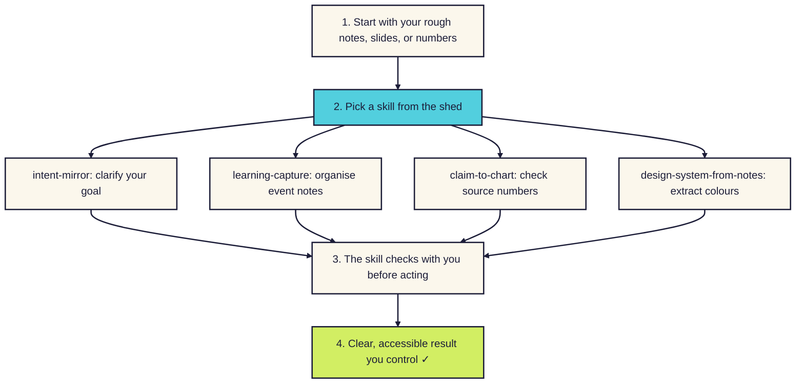

# Skills

Plain-English instructions you give your AI tool so it handles one repeatable job well.

A skill is a text file of instructions. You load it into your AI tool once. After that, it follows those instructions whenever you ask it to do that job.

## Skills made for getting started

Every skill in `skills/` is written for people getting started with AI and skills, rather than established professionals. Each folder holds a plain-English `README.md` guide, a `CHECKS.md` test sheet, and a `SKILL.md` instruction file. You can copy one skill and use it today with zero setup.

## Which skill do I need?

Find your situation in the table below to see which tool fits best.

| If you want to… | Use this tool | What you get |
|---|---|---|
| Sort out a messy brain dump before the AI builds anything | [intent-mirror](intent-mirror/) | A short summary of your goal to check and approve |
| Turn conference slides, photos, or recordings into clear notes | [learning-capture](learning-capture/) | A readable report, a concept mind map, and an action list |
| Check where a number came from and make an accessible chart | [claim-to-chart](claim-to-chart/) | An honest source check and a clear chart with safe colours |
| Pull colours and fonts from a slide or photo to reuse | [design-system-from-notes](design-system-from-notes/) | A one-page mini design system with contrast ratings |

## How to get started with a skill

**In words:** start with whatever you have, such as raw notes, a slide photo, or a number from a talk. Pick the skill that matches your job and paste its `SKILL.md` file into your AI chat tool. Each skill checks with you before it acts, so every path leads to clear work you control.

## Skills in the shed so far

Each skill has its own folder with `README.md` to explain how it works, `CHECKS.md` to list its test cases, and `SKILL.md` with instructions for your AI tool.

| Skill | What it does | Companion story |
|---|---|---|
| [intent-mirror](intent-mirror/) | Turns a messy brain dump into a short summary you check before the AI does anything | [Notes](../notes/intent-mirror.md) |
| [learning-capture](learning-capture/) | Turns event photos, notes, and recordings into a report, a mind map, and an action list | [Notes](../notes/learning-capture.md) |
| [claim-to-chart](claim-to-chart/) | Checks where a statistic came from, then charts it with colours everyone can read | [Notes](../notes/claim-to-chart.md) |
| [design-system-from-notes](design-system-from-notes/) | Takes the colours and fonts from one picture and reuses them so everything matches | [Notes](../notes/design-system-from-notes.md) |

## How to use a skill

To use any skill, you give its `SKILL.md` file to your AI tool.

- Follow [How to add a skill](how-to-add-a-skill.md) for step-by-step guides in Claude, Google Gemini, and ChatGPT.
- Use `./skills/install-skills.sh` to copy the skills in this folder into Claude Code in one step.
- In a hurry? Start a new chat, paste the text of `SKILL.md` as your first message, and send it. Then continue chatting as normal. This works in any tool.

## Adding a new skill

If you want to write a new skill, follow our [README-template.md](README-template.md). It outlines the writing rules, required sections, and accessibility checks.
