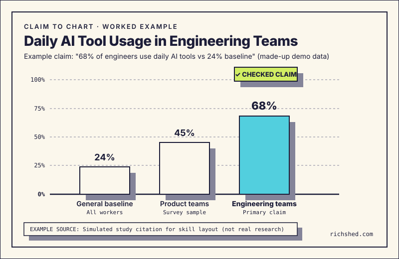

# Claim to chart

**Heard a statistic you want to share? Your AI tool checks where it came from, tells you how solid it is, then makes a chart everyone can read.**

For anyone about to repeat a number from a talk, article or post and wants to get it right. [Read the companion story](../../notes/claim-to-chart.md).

<b>New to this? Words you'll see on this page</b>

- **AI tool**: a chat app you type or talk to, like ChatGPT, Claude, Gemini or Copilot.
- **Skill**: a set of written instructions you give your AI tool so it handles one kind of job the same way every time.
- **Claim**: a fact or number someone said, like "half of workers use AI".
- **Primary source**: the original study or report the number came from, not an article repeating it.
- **Colour-blind safe**: colours that people with common colour blindness can still tell apart.
- **Alt text**: a written description of an image, read aloud by screen readers.

## What it does

- You give it a claim and where you heard it.
- You get back a verdict, the evidence behind it and a chart.
- It checks before it charts. If it can't find the source, it says so instead of guessing.

## How it works

```mermaid
flowchart LR
    accTitle: How claim to chart works
    accDescr: You share a claim. The AI finds the original source and gives a verdict. It then finds related studies, and finally makes a chart with checked colours and alt text.
    A["You: a claim"] --> B["AI: find the original source"]
    B --> C["Verdict"]
    C --> D["Related studies"]
    D --> E["Accessible chart ✓"]
    classDef step fill:#FBF7EC,stroke:#1C1D38,stroke-width:2px,color:#1C1D38
    classDef ask fill:#FFFFFF,stroke:#1C1D38,stroke-width:2px,color:#1C1D38
    classDef focal fill:#52CFDE,stroke:#1C1D38,stroke-width:2px,color:#1C1D38
    classDef done fill:#D2EE63,stroke:#1C1D38,stroke-width:2px,color:#1C1D38
    linkStyle default stroke:#1C1D38,stroke-width:2px
    class A,C,D step
    class B focal
    class E done
```

**In words:** you share a claim. The AI finds where it came from and gives it a verdict. Then it looks at related studies and makes a chart with readable colours and a written description.

## How to use it

### Step 1. Copy the instructions

Open [SKILL.md](SKILL.md). Click the **Copy raw file** button near the top right of the file (two overlapping squares).

### Step 2. Give them to your AI tool

[How to add a skill](../how-to-add-a-skill.md) has steps for Claude, Google Gemini and ChatGPT.

In a hurry? Start a new chat, paste the instructions in as your first message and send it. Then carry on in the next message. This works in any AI tool.

### Step 3. Share the claim

Say exactly what was claimed and where you heard it. For example: "A speaker said women are judged more harshly for using AI at work."

### Step 4. Read the verdict

You'll get one of four:

| Verdict | What it means |
|---|---|
| Confirmed | The source says the same thing |
| Adjusted | It's real, but the number or scope is different |
| Disputed | Good sources disagree |
| Not found | No original source turned up |

### Step 5. Check the chart

Check the numbers match the source, the source is named on the chart, and the caveat is visible.

## What the verdict and chart look like

Here is a worked layout example using sample numbers (made-up demo data). Someone heard a statistic on a panel and wanted to check it before sharing.

**What they said:**

> A speaker on the tech panel said: "68% of software engineers use daily AI assistants now, compared to a 24% baseline across all knowledge workers." Can we check if that is true and draw a chart for my recap?

**What came back:**

> **🔍 Claim card**
>
> - **Original claim**: "68% of software engineers use daily AI assistants now, compared to a 24% baseline across all knowledge workers." (made-up demo data)
> - **Verdict**: Confirmed.
> - **Primary source**: Sample engineering study (made-up demo citation, not a real paper), Table 4 (1,420 engineers surveyed).
> - **What the source found**: The sample study reports 68% of surveyed software engineers use AI code tools daily. Across all office workers, the daily rate was 24%.
>
> **📊 Evidence table**

| Source / Study | Year | Sample / Method | Finding | Agreement |
|---|---|---|---|---|
| Sample engineering study (Primary) | 2026 | Survey of 1,420 engineers (made-up demo data) | 68% daily AI tool use | Primary source |
| Product Craft Survey | 2025 | Survey of 850 product managers (made-up demo data) | 45% daily AI tool use | Adjacent (product) |
| Knowledge Work Index | 2025 | Cross-industry survey (n=4,200, made-up demo data) | 24% daily AI tool use | Confirms baseline |

> **📈 Chart details**
>
> - **Chart form**: Bar chart comparing baseline (24%), product teams (45%), and engineering teams (68%).
> - **Colours**: Paper canvas (`#FBF7EC`), dark ink text (`#1C1D38`), pool blue bar (`#52CFDE`), and lime check badge (`#D2EE63`).
> - **Direct labels**: Each bar shows its number and team name directly on the canvas.
> - **Alt text**: Bar chart showing 68% daily AI tool use in engineering teams versus 45% in product teams and 24% across office workers. Source: Sample engineering study (made-up demo data).
> - **Caveat**: Daily use across software teams. Excludes hobby coders.
>
> **⚠️ What could not be verified**
>
> - The paper counted daily use by asking workers, not by tracking software.

**What each part means:**

| Part | What you see | Why it's there |
|---|---|---|
| Claim card | The original quote, the primary source, and the verdict | Shows the exact claim and whether the study backs it up. Read this first. |
| Verdict label | Confirmed, Adjusted, Disputed, or Not found | Gives an honest status in one plain word so you know if you can trust it. |
| Evidence table | The primary paper alongside adjacent studies | Checks whether other teams found similar numbers or reached different results. |
| Chart specification | Layout, accessible colours, direct labels, and alt text | Sets up a clean visual that everyone can read, with no confusing legends. |
| Caveat line | The sample size and limits shown directly on the canvas | Keeps limits visible so viewers get the whole truth, not just a neat bar. |
| Gaps note | Anything that could not be verified | Flags missing raw data or study limits so you never overclaim. |

## More examples

These are real replies from testing. Click one to open it.

<b>When the number needs adjusting</b>

**What they said:**

> A slide at yesterday's design meetup claimed: "Design systems speed up designer work by 40% across every team." Can we check this?

**What came back:**

> **🔍 Claim card**
>
> - **Original claim**: "Design systems speed up designer work by 40% across every team."
> - **Verdict**: Adjusted.
> - **Primary source**: Figma Design Systems Study (2019), testing 24 designers on set tasks.
> - **What the source found**: Designers finished set tasks 34% faster when using a design system.
> - **Adjustment note**: The actual speed gain was 34%, not 40%. It tested single UI components, not entire projects.
>
> **➡️ Chart advice**\
> Chart the verified 34% figure. Place the sample size (24 designers) and task limits right under the title.

It adjusts the number and notes the limits, saving you from repeating an inflated claim.

<b>When good sources disagree</b>

**What they said:**

> An article quoted an analyst saying: "85% of big AI projects fail before they ever reach production." Is that true?

**What came back:**

> **🔍 Claim card**
>
> - **Original claim**: "85% of big AI projects fail before they ever reach production."
> - **Verdict**: Disputed.
> - **Primary source**: Gartner Analyst Estimate (2018), based on expert opinion.
> - **Counter source**: MIT Sloan Survey (2023, 1,200 firms), finding a 54% stall rate.
> - **Dispute note**: Numbers vary from 54% to 85%. It depends on whether paused trials count as failures.
>
> **➡️ Chart advice**\
> Draw a range chart or show both studies side by side. Do not present one guess as a hard fact.

It places both studies side by side so your audience sees the full picture.

<b>When no source can be found</b>

**What they said:**

> A blog post stated: "84% of website redesigns fail to hit their goals within six months."

**What came back:**

> **🔍 Claim card**
>
> - **Original claim**: "84% of website redesigns fail to hit their goals within six months."
> - **Verdict**: Not found.
> - **Primary source**: None found.
> - **Check**: Traced through five blogs to a dead link from 2016. No study or dataset exists.
>
> **➡️ Chart advice**\
> Do not draw this chart. Find a verified study on project success instead, or skip the number.

It tells you plainly when a number has no source, saving you from sharing fiction.

<b>When you send a messy voice note</b>

**What they said:**

> hey quick voice note from the keynote... speaker said something like 90% of devs use AI every single day now, said it was from Stanford or GitHub maybe? can you check that before we put it in the wrap-up slides? cheers!

**What came back:**

> **🔍 Claim card**
>
> - **Original claim**: "90% of devs use AI every single day now" (attributed to Stanford or GitHub).
> - **Verdict**: Adjusted.
> - **Primary source**: Stanford and GitHub Study (2023, 2,000 developers).
> - **What the source found**: 92% of surveyed developers had tried AI code tools, but 46% used them daily.
> - **Adjustment note**: The speaker mixed up people who tried a tool once with daily users.
>
> **➡️ Chart advice**\
> Show two bars: 92% who tried AI tools versus 46% who use them daily. Label both clearly.

It sorts out the confused memory, finds the real paper, and separates daily use from one-off trials.

## Tips

- **Turn web search on:** Your AI tool needs web search turned on to find research papers.
- **Check the link yourself:** Always open the primary study link before you repeat a number.
- **Value "Not found":** "Not found" is a useful result. It protects you from quoting made-up stats.
- **Keep caveats on canvas:** Place sample sizes directly on the chart so they cannot be cropped out.

## How I tested it

I checked four example claims from talks and articles against a standard charting prompt and this skill, verifying each against primary research papers.

| Example claim scenario | Standard charting prompt | With this skill |
|---|---|---|
| "Design systems boost velocity by 40%" | Draws an unverified 40% bar with no source | *Adjusted*: Traced to Figma 2019 study (34% speed gain, n=24). Added task scope caveat. |
| "85% of enterprise AI projects fail" | Marks "True" and draws a pie chart with no source | *Disputed*: Found Gartner 2018 estimate (85%) alongside MIT Sloan 2023 survey (54%). Plotted both. |
| "72% of neurodivergent staff mask daily" | Draws a generic donut chart without sample details | *Confirmed*: Traced to Birkbeck / Neurodiversity in Business report (n=1,023). Added year and sample size. |
| "84% of website redesigns fail within six months" | Invents a plausible business school citation | *Not found*: Reports that the trail ends at dead blog links and advises against charting. |

This is a small test: one AI tool, one run each, checked by hand against primary sources. You can also read our [written test checks](CHECKS.md) to try them yourself. [Read the full story in the companion notes](../../notes/claim-to-chart.md).

## What's next

Ideas, not promises:

- **Automated contrast checks:** A small script that checks colour contrast automatically before saving.
- **Accessible palettes:** A ready-made library of colour-blind safe palettes for three-bar and four-bar charts.
- **Direct slide export:** Clean export options for presentation decks and social cards.

## Questions

<b>Which AI tools does it work with?</b>

Any AI tool that can search the web. Without web search, it can still format a chart, but it cannot verify the claim.

<b>Does it send my information anywhere?</b>

No. It is only text instructions. Your searches go wherever your AI tool normally sends them.

<b>Can I change it?</b>

Yes. It is a text file. Open it, adjust the wording, and save your own copy.

## Similar skills

Other tools help you visualise data or summarise articles. They are worth a look if you need something different.

| Tool or skill | How it differs | Why keep, fork, or combine |
|---|---|---|
| [Anthropic skills & quickstarts](https://github.com/anthropics/anthropic-quickstarts) by Anthropic | Generates fast visual code from raw data, but accepts any number without verification. | Use for plotting known data tables. Combine with claim-to-chart when numbers need verification first. |
| [Superpowers](https://github.com/obra/superpowers) by Jesse Vincent (`obra`) | Enforces test-driven engineering and strict verification gates for code changes. | Best for software builds. Fork or combine its verification discipline with claim-to-chart data checks. |
| Generic web summarisers (Perplexity, ChatGPT search) | Summarises search results quickly, but often accepts marketing blogs as factual sources. | Good for quick background reading. Keep claim-to-chart to trace primary research and sample sizes. |
| Data journalism tools (Datawrapper, Flourish) | Powerful newsroom chart builders with deep layout options, but no source verification. | Build charts in Datawrapper when you need interactive embeds. Use claim-to-chart to check the stats first. |

Claim-to-chart puts fact-checking before chart-making. It finds the first paper, marks disputed stats, and writes the caveats right on the chart.

## What's in this folder

| File | What it is |
|---|---|
| [README.md](README.md) | This page |
| [SKILL.md](SKILL.md) | The instructions you give your AI tool |
| [CHECKS.md](CHECKS.md) | Written Given/When/Then test cases you can run yourself |
| [Notes](../../notes/claim-to-chart.md) | Why I built it and what changed |
