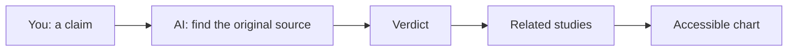

# Claim to chart

**Heard a statistic you want to share? Your AI tool checks where it came from, tells you how solid it is, then makes a chart everyone can read.**

For anyone about to repeat a number from a talk, article or post and wants to get it right.

<b>New to this? Words you'll see on this page</b>

- **AI tool**: a chat app you type or talk to, like ChatGPT, Claude, Gemini or Copilot.
- **Skill**: a set of written instructions you give your AI tool so it handles one kind of job the same way every time.
- **Claim**: a fact or number someone said, like "half of workers use AI".
- **Primary source**: the original study or report the number came from, not an article repeating it.
- **Colour-blind safe**: colours that people with common colour blindness can still tell apart.
- **Alt text**: a written description of an image, read aloud by screen readers.

## What it does

- You give it a claim and where you heard it.
- You get back a verdict, the evidence behind it and a chart.
- It checks before it charts. If it can't find the source, it says so instead of guessing.

## How it works

**In words:** you share a claim. The AI finds where it came from and gives it a verdict. Then it looks at related studies and makes a chart with readable colours and a written description.

## How to use it

### Step 1. Copy the instructions

Open [SKILL.md](SKILL.md). Click the **Copy raw file** button near the top right of the file (two overlapping squares).

### Step 2. Give them to your AI tool

[How to add a skill](../how-to-add-a-skill.md) has steps for Claude, Google Gemini and ChatGPT.

In a hurry? Start a new chat, paste the instructions in as your first message and send it. Then carry on in the next message. This works in any AI tool.

### Step 3. Share the claim

Say exactly what was claimed and where you heard it. For example: "A speaker said women are judged more harshly for using AI at work."

### Step 4. Read the verdict

You'll get one of four:

| Verdict | What it means |
|---|---|
| Confirmed | The source says the same thing |
| Adjusted | It's real, but the number or scope is different |
| Disputed | Good sources disagree |
| Not found | No original source turned up |

### Step 5. Check the chart

Check the numbers match the source, the source is named on the chart, and the caveat is visible.

## Tips

- Your AI tool needs web search turned on for this to work well.
- Always open the source link yourself before you share anything.
- "Not found" is a useful answer. It saves you from repeating something shaky.

## How I tested it

I used it once, on statistics quoted at a conference panel, to make four charts. One claim needed adjusting. That's a small test. Tell me how it goes for you.

## What's next

Ideas, not promises:

- A small colour-checking script anyone can run
- A ready-made set of colour-blind-safe palettes

## Questions

<b>Which AI tools does it work with?</b>

Any AI tool that can search the web. Without search, it can still build the chart, but it can't check the claim.

<b>Does it send my information anywhere?</b>

No. It's only instructions. Your searches go wherever your AI tool normally sends them.

<b>Can I change it?</b>

Yes. It's a text file. Edit it however you like.

## What's in this folder

| File | What it is |
|---|---|
| README.md | This page |
| SKILL.md | The instructions you give your AI tool |
