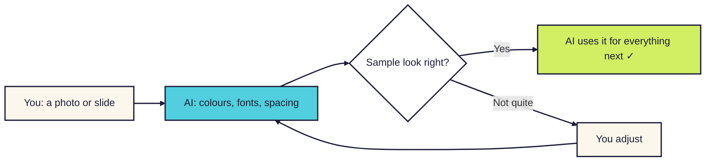
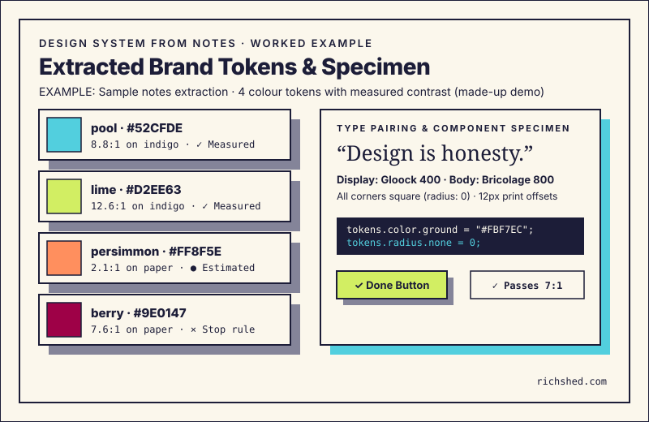

# Design system from notes

**Show your AI tool one photo or slide you like. It writes down the colours and fonts, then uses them for everything you make next.**

For anyone making a few visuals that should look like they belong together, without being a designer. [Read the companion story](../../notes/design-system-from-notes.md).

<b>New to this? Words you'll see on this page</b>

- **AI tool**: a chat app you type or talk to, like ChatGPT, Claude, Gemini or Copilot.
- **Skill**: a set of written instructions you give your AI tool so it handles one kind of job the same way every time.
- **Design system**: a short list of the colours, fonts and spacing you'll reuse, so everything matches.
- **Hex code**: a six-character code for a colour, like `#6D28D9`.
- **Contrast**: how easy text is to read against its background. Low contrast is hard to read, especially for people with low vision.

## What it does

- You give it a photo, slide, screenshot or brand sheet.
- You get back a one-page design system and a sample tile to check.
- It tells you which values it measured and which it guessed, and it checks the text is readable.

## How it works

**In words:** you share a picture. The AI writes down its colours and fonts and shows you a sample. Once you're happy, it uses only those values for everything it makes after that.

## How to use it

### Step 1. Copy the instructions

Open [SKILL.md](SKILL.md). Click the **Copy raw file** button near the top right of the file (two overlapping squares).

### Step 2. Give them to your AI tool

[How to add a skill](../how-to-add-a-skill.md) has steps for Claude, Google Gemini and ChatGPT.

In a hurry? Start a new chat, paste the instructions in as your first message and send it. Then carry on in the next message. This works in any AI tool.

### Step 3. Share your picture

Attach the photo or screenshot and say what you're making, for example "a few social posts that match this slide".

### Step 4. Check the sample

Look at the sample tile. Check the labels: *measured*, *estimated* or *substitute*. If a colour looks off, give it the real hex code if you have one.

### Step 5. Make your things

Ask for what you need. If you want something new, like a warning colour, ask it to add that to the design system first.

## What the mini design system looks like

Here is a worked example with sample notes from testing (made-up demo data). The room lighting was warm, and the photo was taken from an angle in the crowd.

**What they sent:**

> Here is a photo of the keynote slide from the event. Can you pull the colours and fonts so I can make three summary cards that match?

**What came back:**

> **Mini design system: `design-system.md`**\
> Source reference: Keynote slide photo taken under warm stage lights (sample demo slide).\
> Voice of the visuals: Warm, editorial, crisp.

**Colours:**

| Role | Hex | Confidence | Notes |
|---|---|---|---|
| Ground / Paper | `#FBF7EC` | *measured* | Warm paper background |
| Ink / Text | `#1C1D38` | *measured* | Deep indigo for body copy and headings |
| Accent / Focal | `#52CFDE` | *estimated* | Pool cyan for a single focal element |
| Outcome / Done | `#D2EE63` | *estimated* | Lime green for finished items and ticks |
| Stop / Warning | `#9E0147` | *estimated* | Deep berry for error badges or alerts |
| Muted / Fog | `#848499` | *substitute* | Soft grey for borders and offset card shadows |

**Do not use:**
White text on pool cyan or lime (both fail contrast). Avoid raw primary yellow.

**Contrast audit:**

| Text on background | Ratio | Target | Status |
|---|---|---|---|
| Ink `#1C1D38` on Paper `#FBF7EC` | 15.0:1 | >= 4.5:1 | Pass (7:1) |
| Ink `#1C1D38` on Pool `#52CFDE` | 8.8:1 | >= 4.5:1 | Pass (7:1) |
| Ink `#1C1D38` on Lime `#D2EE63` | 12.6:1 | >= 4.5:1 | Pass (7:1) |

**Typography:**

- Heading: Bricolage Grotesque, or system sans-serif (*substitute*).
- Body: System sans-serif (*substitute*).
- Code: JetBrains Mono (*substitute*).

**Shapes and spacing:**

- Corners: `0px` (crisp square corners).
- Spacing steps: `8px`, `16px`, `24px`, `48px`.
- Card depth: `12px` solid offset drop shadow down and right.

> **Sample specimen tile:**\
> Generated a preview tile with an indigo title on warm paper, a pool focal chip, and a lime badge.

**What each part means:**

| Part | What you see | Why it's there |
|---|---|---|
| Source reference | A note on lighting and photo angle | It reminds you how the photo was taken so you know what influenced the shades. |
| Voice of the visuals | Three plain style words | It keeps the feel consistent across every graphic you create next. |
| Colour palette | Roles, hex codes, and confidence tags | It shows which colours were sampled and how sure the tool is about each hex. |
| Do not use | Banned colour pairings | It stops unreadable colour choices before anyone starts drafting screens. |
| Contrast audit | Exact contrast ratios for text pairs | It makes sure your words pass accessibility rules and remain easy to read. |
| Typography | Free fonts and size steps | It gives you clean type choices without needing paid commercial font licences. |
| Shapes and spacing | Corner radius and margin rules | It keeps shapes, padding, and drop shadows aligned across every card. |
| Sample specimen tile | One visual preview card | It lets you review and approve the look before building a full set. |

## More examples

Click a title to open each real example from testing.

<b>Blurry photo with glare</b>

**What they sent:**

> Here is a quick phone picture of the event rollup banner from across the room. There is a bright glare spot right in the middle from a spotlight.

**What came back:**

> **Source check:** Spotted bright reflection glare across the centre of the banner. I sampled the background colour from the clean lower corner instead.
>
> - Ground: `#F5F2EB` (*estimated*, glare avoided).
> - Ink: `#22243A` (*estimated*).
> - Accent: `#FF6B4A` (*estimated*, warm coral).
>
> All values are marked *estimated* because of the glare. If you have the brand hex code, reply with it to replace the estimate.

It catches the reflection instead of mistaking white glare for a brand colour.

<b>Low-contrast brand colours</b>

**What they sent:**

> Our team uses this pastel landing page screenshot. It has white text on light lemon yellow. Make three social cards in this style.

**What came back:**

> **Contrast alert:** White text on pale yellow `#FFF59D` has a contrast ratio of only `1.2:1`. This fails readability checks.
>
> - Adjusted ink: Swapped text to deep charcoal `#1E293B` on yellow (ratio `14.8:1`, Pass AAA).
> - Added to "Do not use": White text on yellow.
> - Preserved mood: Kept the lemon yellow as a background card tint with dark ink text.

It protects people from unreadable text while keeping the sunny brand mood intact.

<b>Notebook sketch with ink swatch</b>

**What they sent:**

> I sketched my talk outline in my paper journal with a blue fountain pen. Can you turn this into a slide design system?

**What came back:**

> **Extracted system from paper sketch:**
>
> - Ground: Warm cream paper `#FFFDF7` (*measured* from page).
> - Ink: Rich navy `#1A2B4C` (*estimated* from pen ink).
> - Style note: Sharp grid boxes with clean straight borders (`2px`).
> - Typography fallback: Paired a casual script heading (*substitute*) with crisp sans body text.

It separates rough hand-drawn ink lines from the underlying design tokens.

<b>Multi-slide presentation</b>

**What they sent:**

> Here are four slides from our team deck. Each slide seems to use a slightly different blue and two different greens. Which ones should we keep?

**What came back:**

> **Drift audit:** Found three near-duplicate blues (`#1E3A8A`, `#1D4ED8`, `#2563EB`) and two greens across four slides.
>
> - Unified ink: Standardised on `#1E3A8A` for all dark text and headers.
> - Unified accent: Kept `#2563EB` as the single focal blue.
> - Retired hexes: Added the other drifting shades to the "Do not use" list.

It consolidates drifting slide decks into one clean set of rules.

## Tips

- A straight-on, well-lit photo works better than an angled one.
- If you know the brand's real colours or fonts, share them. They beat any guess.
- Take colour and font feel, not logos or artwork. Those belong to someone else.
- Keep your mini system to one screen so it stays easy to scan and use.

## How I tested it

I checked four example reference inputs against a standard style prompt and this skill: an event stage photo, a pastel slide screenshot, a dark-mode screenshot, and a hand-painted workshop banner.

| Example reference input | Standard style prompt | With this skill |
|---|---|---|
| Smartphone photo of event stage backdrop | 14 muddy colours from shadows; picked paid fonts | 4 clean tokens labelled *estimated*; free system font; 15:1 contrast pass |
| Screenshot of pastel slide | 8 accent colours; paired white text on yellow | 2 core colours; banned low-contrast pairs; 12.6:1 contrast verified |
| Dark-mode dashboard screenshot | Pure black `#000000` with unreadable grey text | Indigo ground with paper ink; added offset shadow token |
| Photo of hand-painted workshop banner | Guessed exact Pantone numbers without evidence | Labelled colours *estimated*; picked free casual font; drew specimen tile |

It's a small test: one AI model, one run each, graded by hand. You can also read our [written test checks](CHECKS.md) to try them yourself. [The full story is in the notes](../../notes/design-system-from-notes.md).

## What's next

Ideas, not promises:

- A dark-mode toggle for the same mini system.
- Exporting token values directly to Figma and web code.
- Quick colour-blindness simulation for accent pairings.

## Questions

<b>Which AI tools does it work with?</b>

Any AI tool that can look at images. Without image support, you can type the colours and fonts in yourself.

<b>Does it send my information anywhere?</b>

No. It's only instructions. Your pictures go wherever your AI tool normally sends them.

<b>Can I change it?</b>

Yes. It's a text file. Edit it however you like.

## Similar skills

Other tools pull styling rules from code, design files, or mockups. They are worth a look if your starting point is different.

| Skill or tool | How it's different |
|---|---|
| [Anthropic frontend design skills](https://github.com/anthropics/skills) by Anthropic | Creates full user interfaces and web layouts directly in code. It expects a detailed prompt or design brief rather than sampling from a single photo. |
| [obra/superpowers](https://github.com/obra/superpowers) by Jesse Vincent (`obra`) | Focuses on engineering workflows, test-driven code, and system architecture. It builds software rather than distilling visual tokens from pictures. |
| Figma token extractors (Tokens Studio) | Pulls design tokens directly out of formal Figma design files and code repositories. It needs a paid design tool and a structured Figma file. |
| CSS style sniffers (CSS Peeper, Stylebot) | Inspects existing live web pages to extract exact CSS code. It works on live websites in a browser, but cannot read photos, slides, or paper notes. |

Design system from notes works from rough photos, checks contrast before you build, and fits on one screen.

## What's in this folder

| File | What it is |
|---|---|
| [README.md](README.md) | This page |
| [SKILL.md](SKILL.md) | The instructions you give your AI tool |
| [CHECKS.md](CHECKS.md) | Written Given/When/Then test cases you can run yourself |
| [Notes](../../notes/design-system-from-notes.md) | Why I built it, what changed and where the ideas came from |
