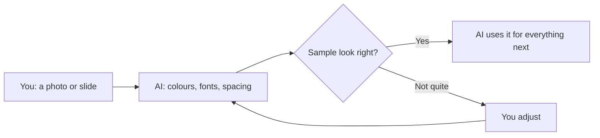

# Design system from notes

**Show your AI tool one photo or slide you like. It writes down the colours and fonts, then uses them for everything you make next.**

For anyone making a few visuals that should look like they belong together, without being a designer.

<b>New to this? Words you'll see on this page</b>

- **AI tool**: a chat app you type or talk to, like ChatGPT, Claude, Gemini or Copilot.
- **Skill**: a set of written instructions you give your AI tool so it handles one kind of job the same way every time.
- **Design system**: a short list of the colours, fonts and spacing you'll reuse, so everything matches.
- **Hex code**: a six-character code for a colour, like `#6D28D9`.
- **Contrast**: how easy text is to read against its background. Low contrast is hard to read, especially for people with low vision.

## What it does

- You give it a photo, slide, screenshot or brand sheet.
- You get back a one-page design system and a sample tile to check.
- It tells you which values it measured and which it guessed, and it checks the text is readable.

## How it works

**In words:** you share a picture. The AI writes down its colours and fonts and shows you a sample. Once you're happy, it uses only those values for everything it makes after that.

## How to use it

### Step 1. Copy the instructions

Open [SKILL.md](SKILL.md). Click the **Copy raw file** button near the top right of the file (two overlapping squares).

### Step 2. Give them to your AI tool

[How to add a skill](../how-to-add-a-skill.md) has steps for Claude, Google Gemini and ChatGPT.

In a hurry? Start a new chat, paste the instructions in as your first message and send it. Then carry on in the next message. This works in any AI tool.

### Step 3. Share your picture

Attach the photo or screenshot and say what you're making, for example "a few social posts that match this slide".

### Step 4. Check the sample

Look at the sample tile. Check the labels: *measured*, *estimated* or *substitute*. If a colour looks off, give it the real hex code if you have one.

### Step 5. Make your things

Ask for what you need. If you want something new, like a warning colour, ask it to add that to the design system first.

## Tips

- A straight-on, well-lit photo works better than an angled one.
- If you know the brand's real colours or fonts, give them. They beat any guess.
- Take colour and font feel, not logos or artwork. Those belong to someone else.

## How I tested it

I used it once, on photos of conference slides, to make a social media carousel and four charts that matched. That's a small test. Tell me how it goes for you.

## What's next

Ideas, not promises:

- A dark-mode version of the same system
- Exporting the values in formats design tools can read

## Questions

<b>Which AI tools does it work with?</b>

Any AI tool that can look at images. Without image support, you can type the colours and fonts in yourself.

<b>Does it send my information anywhere?</b>

No. It's only instructions. Your pictures go wherever your AI tool normally sends them.

<b>Can I change it?</b>

Yes. It's a text file. Edit it however you like.

## What's in this folder

| File | What it is |
|---|---|
| README.md | This page |
| SKILL.md | The instructions you give your AI tool |
