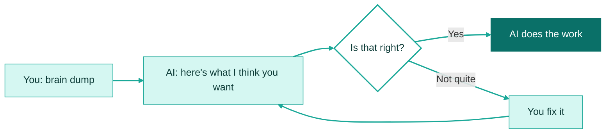
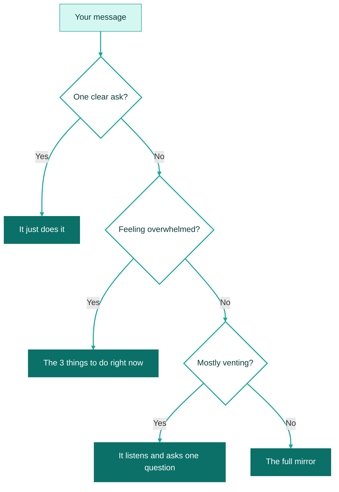

# Intent mirror

**Say what's on your mind, however messy. The AI tells you back what it thinks you want, then waits for your OK before it does anything.**

I built this for my ADHD brain. It works for anyone who thinks out loud. [Read why I built it](../../notes/intent-mirror.md).

<b>New to this? Five words you'll see on this page</b>

- **AI tool**: a chat app you type or talk to, like ChatGPT, Claude, Gemini or Copilot.
- **Skill**: a set of written instructions you give your AI tool so it handles one kind of job the same way every time. This skill is one text file.
- **Brain dump**: everything in your head about something, typed or said in one go. It doesn't need to be tidy.
- **Mirror**: the short summary the AI sends back so you can check it understood you.
- **Default**: the answer the AI will go with unless you say otherwise.

## What it does

- You get a short summary of what you asked for, in your own words.
- It picks sensible answers for the small stuff, so you're not stuck answering questions.
- Nothing gets made until you say "yes". If it got something wrong, you fix it first, before it wastes your time.

## How it works

**In words:** you dump your thoughts. The AI sends back a short summary. If it's right, you say "yes" and it gets to work. If it's not, you say what's wrong and it fixes the summary.

## How to use it

You don't need to be technical. If you can copy and paste, you can do this.

### Step 1. Copy the instructions

Open [SKILL.md](SKILL.md). Near the top right of the file there's a button with two overlapping squares, called **Copy raw file**. Click it. The whole file is now copied.

### Step 2. Give them to your AI tool

[How to add a skill](../how-to-add-a-skill.md) has steps for Claude, Google Gemini and ChatGPT.

In a hurry? Start a new chat, paste the instructions in as your first message and send it. Then send your brain dump as the next message. This works in any AI tool.

### Step 3. Do your brain dump

Type it or say it out loud. Ramble. Change your mind halfway through. Leave in the "ums". You can start with "brain dump:" so the AI knows what's coming, but you don't have to.

### Step 4. Read the mirror

It takes about a minute. Check two things:

- Did it get the main thing right?
- Are you OK with the defaults it picked?

### Step 5. Reply

| If… | Say… |
|---|---|
| It's right | **yes** |
| You want a different option | the number and letter, like **1B** |
| Something's wrong | what's wrong, in your own words. No special format. |

### Step 6. Let it work

Once you say yes, the AI does the job it just described back to you.

## What the mirror looks like

Here's a real reply to a messy voice note. The voice-to-text heard "slides" as "sliders" and a name wrong, and the person corrected themselves mid-sentence.

**What they said:**

> okay so um the sliders for thursday, no, the slides for the board thing, and gem said, actually not gem, whatever, we need the numbers from last quarter or the quarter before I can't remember. and um. it has to look less boring than last time. also the cat needs feeding. okay bye

**What came back:**

> **🪞 What you want**\
> Put together the slides for "the board thing" using the quarterly numbers, and make them "less boring than last time".
>
> **🎯 Goals**
>
> - Build the board slides with the quarterly numbers
> - Make them look "less boring than last time"
> - Feed the cat (that one's yours, now)
>
> **⚠️ Constraints**
>
> - Audience is the board
> - Someone (not Gem) asked for the numbers
>
> **✋ Assuming**
>
> - Due Thursday. You said "Thursday" before you corrected "sliders" to "slides".
> - Same content shape as last time, with a fresher look.
>
> **❓ Decide**
>
> 1. Numbers: last quarter (default) / the quarter before / both, side by side
> 2. Scope: restyle last deck with new numbers (default) / new deck from scratch
>
> **➡️ Next step**\
> Draft a slide-by-slide outline with gaps marked for the numbers, plus a visual direction that's less boring than last time.
>
> Reply yes to go with the defaults, pick (e.g. 1B), or tell me what's off.

**What each part means:**

| Part | What it's for |
|---|---|
| 🪞 What you want | The main thing, in your words. Read this first. If it's wrong, say so before anything else. |
| 🎯 Goals | Everything you asked for, most important first. |
| ⚠️ Constraints | Deadlines, people and limits you mentioned. It never makes these up. |
| ✋ Assuming | Small guesses it made so it doesn't have to ask you. Say so if one's wrong. |
| ❓ Decide | Only the questions that would change the work. Each has a default, so "yes" answers all of them. |
| 🅿️ Parked | Things you said that aren't jobs, like letting off steam. It heard them, and it won't act on them. |
| ➡️ Next step | Exactly what it will do when you say yes. |

Sections with nothing in them are left out, so most mirrors are shorter than this one.

## It changes shape to fit your message

**In words:**

| You send… | You get… |
|---|---|
| One clear ask | It just does it. If the job is big or hard to undo, it checks in one line first. |
| A messy dump with lots in it | The full mirror, like the one above |
| "I'm drowning" | Three things to do right now, and everything else parked |
| Mostly venting | One sentence to show it heard you, and one question |
| Just a file or link | "What are you trying to do with this?" |

## It works with your other skills

If you've added other skills to your AI tool, intent mirror names the one that should do the job.

**When you have a skill that fits** (here, one called budget-sheets), the last line says so:

> **➡️ Next step**\
> Build the budget spreadsheet with category totals from your receipts (budget-sheets skill), then draft the message to your partner in the reply for you to send.

**When none of your skills fits, but one would help,** it tells you what kind to look for:

> **➡️ Next step**\
> Build last month's budget with category totals from your receipts, then draft the message to your partner.\
> No spreadsheet skill loaded. One would help: look in your tool's skill library or a public skills collection, or I'll do it directly.

It only names skills it can see, and it never goes looking for one before you say yes. Some tools, like Gemini Gems, can't see your other skills. There, list your skills in the "Handoffs" section near the end of SKILL.md, and it will use that list.

## More examples

These are real replies from testing. Click one to open it.

<b>When you're overwhelmed</b>

**What they said:**

> I'm drowning. the budget report is due Monday, I promised the team a roster by yesterday, two people are waiting on me to sign off their leave, my kid's school form is due tomorrow, the website copy is half done and I haven't checked email since lunch. I don't know where to start.

**What came back:**

> **🎯 The 3 things right now**
>
> 1. Sign off the two leave requests ← start here
> 2. Send the team the roster you promised yesterday
> 3. Fill in your kid's school form, due tomorrow
>
> **🅿️ Parked:** budget report (due Monday), half-done website copy, email since lunch.
>
> Reply yes, or swap any.

It skips the questions and the extra sections, and puts things other people are waiting on first.

<b>When you just need to vent</b>

**What they said:**

> ugh. spent my whole weekend on the cake stall for the school fete and the committee said it 'wasn't quite what they pictured'. I followed their list exactly. whatever. just needed to say that somewhere.

**What came back:**

> You gave up your whole weekend for the cake stall, followed their list exactly, and the committee still came back with "not quite".
>
> When they said it "wasn't quite what they pictured", what would you like to have happen? Or did you just need to get it out? Both are fine.

It doesn't make a to-do list or give advice you didn't ask for.

<b>When the ask is already clear</b>

**What they said:**

> Turn these into a quick group chat message for the netball team, friendly tone:
>
> - training moved to Thursday 6pm
> - same court
> - bring water, it's meant to be hot

**What came back:**

> Hey team! 👋 Quick heads up: training's moved to **Thursday at 6pm**, same court as usual. It's meant to be a hot one, so bring plenty of water! See you there 💪

It skips the mirror, because checking first would only slow you down.

<b>When you only send a link</b>

**What they said:**

> https://example.com/files/q3-results-final-v2.pdf

**What came back:**

> What are you trying to do with this?

It doesn't guess and it doesn't start reading.

<b>When you fix the mirror</b>

The mirror said they wanted a flyer for a street party and an email to the council. They replied:

> nah not a flyer, nobody reads those, do a message for the street group chat. and skip the council, Pat already sorted it. rest is right.

**What came back:**

> Updated: a message for the street group chat instead of a flyer. Council email dropped, Pat's already sorted the road.
>
> **➡️ Next step**\
> Draft the group chat message and the sign-up list.
>
> Reply yes, or tell me what's off.

It sends only what changed.

## Tips

- **Talk instead of typing** if that's easier. Voice notes and transcripts work fine, mistakes and all.
- **"yes" is always enough:** the defaults are there so you don't have to think about the small stuff.
- **Fix it in your own words:** "No, it's for Sam" works. You don't need the section names.
- **Make it yours:** it's a text file. Open it, change the wording, and save your own copy.

## How I tested it

I wrote seven test messages: a rambling voice note, an overwhelmed one, a clear ask, a vent, one that contradicts itself, one that names the wrong solution, and a correction. I ran each through the old and new versions of this skill and checked the replies against a list of things a good mirror should do.

| | Old version | This version |
|---|---|---|
| Checks passed | 43% | 100% |
| Overwhelmed message | 204 words | 54 words |
| Clear ask | Asked "Go ahead?" first | Just did it |
| Fixing a mistake | Sent the whole mirror again | Sent only the change |

It's a small test: one AI, one run each, marked by me. [The full story is in the notes](../../notes/intent-mirror.md#how-i-tested-it).

## What's next

Ideas, not promises:

- **Screen reader mode:** screen readers read emoji names out loud, like "mirror" and "bullseye". An option for plain headings would make the mirror easier to listen to.
- **A short version** for AI tools with small instruction boxes.
- **Spot life admin:** "The cat needs feeding" landed in Goals. It should go in Parked as a reminder for you.
- **Listen mode:** a mirror short enough to hear on a voice assistant.
- **Test with more people,** with and without ADHD, and with more real voice notes.

## Questions

<b>Which AI tools does it work with?</b>

Any tool that lets you give it written instructions, which is nearly all of them. If yours has nowhere to save instructions, paste them at the start of each chat.

<b>Does it send my information anywhere?</b>

No. It's just instructions. It doesn't connect to anything. Your AI tool's usual privacy settings still apply.

<b>I don't have ADHD. Is this for me?</b>

Yes. I built it for my ADHD brain, but accessible design usually helps more people than it was made for. Voice input is a good example.

<b>Can I change it?</b>

Yes, please do. The "Handoffs" section near the end is made to be filled in with your own tools and templates.

## Similar skills

Other people have built skills that clarify what you mean before the AI starts. They're worth a look if this one isn't quite right for you.

| Skill | How it's different |
|---|---|
| [grilling (grill-me)](https://skills.sh/mattpocock/skills/grilling) by Matt Pocock | Asks you numbered questions in rounds, each with a recommended answer, until you agree on a plan. It got to the "yes accepts the defaults" idea first. |
| [Superpowers brainstorming](https://github.com/obra/superpowers/blob/main/skills/brainstorming/SKILL.md) by obra | Asks one question at a time, leading with a recommended option. Built for designing software. |
| [Clarify-Intent](https://github.com/irfanannaafi19/Clarify-Intent) | Asks 5 to 7 questions when an instruction is unclear, then gets to work. |
| [Prompt Improver](https://github.com/severity1/claude-code-prompt-improver) | Checks every prompt in Claude Code and asks multiple-choice questions when one is vague. Coding tool only. |
| [brain-dump](https://www.skills.sh/thecraighewitt/skills/brain-dump) by Craig Hewitt | Turns a dump straight into projects and tasks, and saves questions for the end. |

Intent mirror plays back what you meant first, asks as little as possible, and has its own replies for overwhelm and venting.

## What's in this folder

| File | What it is |
|---|---|
| [README.md](README.md) | This page |
| [SKILL.md](SKILL.md) | The instructions you give your AI tool |
| [Notes](../../notes/intent-mirror.md) | Why I built it, what changed and where the ideas came from |
