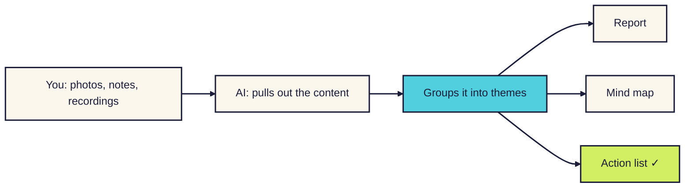
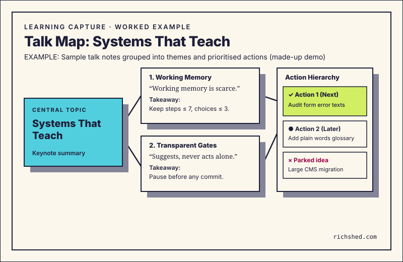

# Learning capture

**Been to a talk, course or conference? Give your AI tool your photos, notes or recording. You get back a report, a map of the ideas and a to-do list.**

For anyone who comes home from an event with a camera roll full of slides and never looks at them again. [Read the companion story](../../notes/learning-capture.md).

<b>New to this? Words you'll see on this page</b>

- **AI tool**: a chat app you type or talk to, like ChatGPT, Claude, Gemini or Copilot.
- **Skill**: a set of written instructions you give your AI tool so it handles one kind of job the same way every time.
- **Transcript**: a written version of a recording.
- **Mind map**: a picture with the main topic in the centre and ideas branching out from it.
- **Action list**: a short list of concrete next steps, with the first one marked.

## What it does

- You give it whatever you have: photos, notes, a recording or links.
- You get back a short report, a mind map and an action list.
- It keeps what speakers said separate from what you think, and flags anything it could not read or check.

## How it works

**In words:** you share what you collected. The AI pulls out the content and groups it into themes. You get a report, a mind map and an action list.

## How to use it

### Step 1. Copy the instructions

Open [SKILL.md](SKILL.md). Click the **Copy raw file** button near the top right of the file (two overlapping squares).

### Step 2. Give them to your AI tool

[How to add a skill](../how-to-add-a-skill.md) has steps for Claude, Google Gemini and ChatGPT.

In a hurry? Start a new chat, paste the instructions in as your first message and send it. Then carry on in the next message. This works in any AI tool.

### Step 3. Share your material

Attach everything at once. Add a line about the event: what it was, and what you want from it.

### Step 4. Check the gaps

Read the "gaps" note first. It lists anything it could not read or hear. Fill in what you can.

### Step 5. Pick your first action

The action list marks one thing to do first. Do that one. Ask for extras, like a social post or flashcards, if you want them.

## What you'll get back

Here is a worked example with sample notes from testing (made-up demo data).
The input was one slide photo.
It also had a 45-second audio clip.
It had two quick text notes.

**What was shared.**

> - Slide photo: "Design Tokens in Production".
> - Point 1: Token names matter more than tools.
> - Point 2: Designers own semantics.
> - Point 3: Engineers own platforms.
> - Point 4: Teams saw a 40% drop in review time (made-up demo claim).
> - Audio note: "Maya said ops reviews tokens weekly. Squads ship changes directly if tests pass."
> - Quick note: "Docs are a trap. Tests are the real spec. Check our repo with Sarah."

**What came back.**

> **1. Summary report.**
>
> **Session:** Design Ops Sydney (sample demo session). Speaker: Maya Lin (sample demo name). Date: 14 October 2026.
>
> **Main idea:** Design tokens work best when treated as live code.
>
> **Theme 1: Ownership.**
> - *Source says:* "Designers own semantics. Engineers own platforms. Squads ship changes if tests pass." (Maya Lin, Slide 4.)
> - *My reaction:* Our mobile squad fears broken builds. We need snapshot tests before they will trust direct commits.
> - *Gaps:* How does Maya's team handle name changes across legacy apps?
>
> **Theme 2: Live tests over static docs.**
> - *Source says:* "Docs are a trap. The test suite is the living spec." (Maya Lin, audio at 0:32.)
> - *My reaction:* We spend two days every month on wiki pages that nobody reads. Moving checks to git will save time.
>
> **2. Mind map.**
>
> - **Tokens in production.**
>   - **Ownership.**
>     - Designers own semantics.
>     - Engineers own platform code.
>     - Weekly ops review.
>   - **Living spec.**
>     - Tests replace static wiki docs.
>     - Fast checks unblock self-service shipping.
>
> **3. Action list.**
>
> | Action item | Priority | Owner | Time appetite | Unblocks |
> |---|---|---|---|---|
> | Check token repo with Sarah | #1 (Start here) | You | 15 mins | Baseline review |
> | Draft snapshot check plan for mobile | #2 | You | 1 hour | Squad trust |
> | Archive old token wiki pages | #3 | Design Ops | 30 mins | Team clarity |
>
> **4. Gaps and unchecked claims.**
>
> - **Unchecked claim:** Slide 4 stated a "40% drop in review time". Run this through `claim-to-chart` to verify numbers before quoting it.
> - **Audio gap:** The first 8 seconds had crowd noise. The question was partly inferred.

**What each part means:**

| Part | What you see | Why it's there |
|---|---|---|
| Summary report | Main idea and themes, split into *Source says* and *My reaction*. | Keeps speaker quotes separate from your thoughts so you never mix them up. |
| Mind map | A structured map from the main topic to branch points. | Gives you a clean visual overview of how the main ideas connect. |
| Action list | Three sized next steps, with "#1 Start here" marked clearly. | Stops to-do list panic by giving you one small task to do right away. |
| Gaps and unchecked claims | Low-quality media notes and unverified numbers flagged for review. | Protects you from repeating shaky claims or guessing at missing words. |

## More examples

These are real examples from testing. Click one to open it.

<b>Partially obscured slide</b>

**What was shared:**

A phone photo of a slide taken from the back of a hall. An attendee's head blocks the bottom left corner. Part of the diagram is hidden.

**What came back:**

The skill extracts the visible text. It makes no guesses about the hidden words. Under "Gaps", it notes:

> Slide 12: Bottom-left corner blocked by attendee head. Extracted points 1 and 2 cleanly. Point 3 is hidden. Ask the speaker for the deck if this point is critical.

Action #1 is set to: "Email speaker for slide deck (5 mins)".

It never invents what was hidden. It tells you plainly what was missing.

<b>Overwhelmed 10-minute memo</b>

**What was shared:**

A rambling 10-minute voice memo recorded on the walk to the train. The speaker vents about work, quotes three talks, worries about a deadline, and changes topics often.

**What came back:**

The skill puts the venting and stress into *My reaction*. It extracts three clean workshop themes with speaker names. It trims 18 potential chores down to three sized action items. It marks a 10-minute quick win as "#1 Start here".

It stops task overload. Instead of drowning in twenty chores, you get one small thing to do now.

<b>Technical workshop architecture</b>

**What was shared:**

A whiteboard photo showing box-and-arrow service diagrams. It also had five terminal commands from a systems session.

**What came back:**

The skill turns the whiteboard sketch into a structured text map. It groups services by domain. It lists key interface rules and trade-offs. It flags untested shell commands for review in a test space before running them on live servers.

It turns whiteboard scribbles into a clean reference that teammates can read.

<b>Panel debate with conflicting views</b>

**What was shared:**

An audio transcript of a four-person panel debate. Two speakers disagree on whether design systems need strict central gates or open contribution models.

**What came back:**

The summary report builds a comparison table. It shows where panellists agree, like shared token foundations. It shows where they clash on governance. Every quote links to the speaker who said it.

It creates no false agreement. It highlights real debates so your team can weigh the trade-offs.

## Tips

- Photograph slides straight on. Blurry photos lose detail.
- Recordings work better than memory, but ask before you record anyone.
- Treat any statistic as unchecked until you have verified the primary source. [Claim to chart](../claim-to-chart/) can help.
- Do not let notes pile up. Run your materials through the skill on the commute home while the talk is fresh.

## How I tested it

I checked four messy example inputs against a standard summarising prompt and this skill: a noisy voice memo, 14 phone photos with blurry slides, hasty notes mixed with brainstorms, and a full-day workshop deck.

| Example input | Standard summary prompt | With this skill |
|---|---|---|
| Noisy voice memo | Blended spoken complaints into speaker quotes | Kept speaker quotes separate from personal notes |
| 14 phone slide photos (3 blurry) | Guessed text on unreadable slides | Extracted 11 slides; flagged 3 blurry slides in gaps list |
| Hasty notes and brainstorms | Made 22 unranked to-do items | Made 3 sized actions with "#1 Start here" marked |
| Full-day workshop deck | 15 pages of repetitive text | 1-page report, concept map and clean next steps |

It is a small test: one AI tool, one run each, scored by me. You can also read our [written test checks](CHECKS.md) to try them yourself. [The full story is in the notes](../../notes/learning-capture.md).

## What's next

Ideas, not promises:

- Templates for different events, like a multi-day course versus an hour talk.
- A follow-up check one week later: did you do the first action?
- Direct export into common note apps like Obsidian, Notion or Apple Notes.

## Questions

<b>Which AI tools does it work with?</b>

Any AI tool that accepts written instructions. Photos need a tool that can read images. Recordings need a tool that transcribes audio, or you can paste in a transcript.

<b>Does it send my information anywhere?</b>

No. It is only instructions. It has no network connections or hidden trackers. Your files go wherever your AI tool normally sends them.

<b>Can I change it?</b>

Yes. It is a plain text file. Open `SKILL.md`, adjust the instructions or output sections to suit your workflow, and save your copy.

<b>What if half of my photos are blurry?</b>

The skill extracts what it can read clearly. It lists blurry or cut-off images under "Gaps" so you know what is missing. It never invents missing text.

## Similar skills

Other tools help you summarise notes or transcribe audio. Here is how learning capture compares and when you might pick another tool:

| Tool or skill | How it works | When to use it instead |
|---|---|---|
| [Anthropic doc & summary skills](https://github.com/anthropics/skills) by Anthropic | Summarises business calls and documents into meeting minutes and task lists. | Best for scheduled team meetings with agendas and known attendees. |
| [brain-dump](https://www.skills.sh/thecraighewitt/skills/brain-dump) by Craig Hewitt | Turns free-form thought dumps directly into projects and tasks. | Best when sorting your own project ideas rather than outside talks. |
| Generic transcription tools (Otter, Whisper) | Produces word-for-word transcripts from audio recordings. | Best when you need an exact legal or research record. |
| Obsidian lecture plugins | Converts markdown notes into spaced repetition flashcards and links. | Best for students studying for exams inside a personal notes vault. |

**Why keep learning capture?**
Most tools either create wordy transcripts or dump twenty unranked chores. Learning capture separates speaker claims from your reactions, draws a clean concept map, and gives you one sized task to do first.

## What's in this folder

| File | What it is |
|---|---|
| [README.md](README.md) | This page |
| [SKILL.md](SKILL.md) | The instructions you give your AI tool |
| [CHECKS.md](CHECKS.md) | Written Given/When/Then test cases you can run yourself |
| [Notes](../../notes/learning-capture.md) | Why I built it, what changed and how it was tested |
