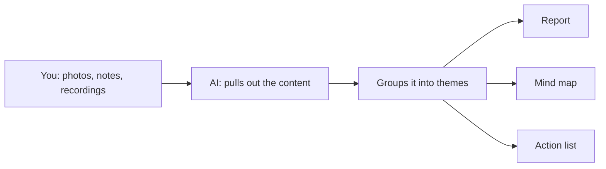

# Learning capture

**Been to a talk, course or conference? Give your AI tool your photos, notes or recording. You get back a report, a map of the ideas and a to-do list.**

For anyone who comes home from an event with a camera roll full of slides and never looks at them again.

<b>New to this? Words you'll see on this page</b>

- **AI tool**: a chat app you type or talk to, like ChatGPT, Claude, Gemini or Copilot.
- **Skill**: a set of written instructions you give your AI tool so it handles one kind of job the same way every time.
- **Transcript**: a written version of a recording.
- **Mind map**: a picture with the main topic in the middle and ideas branching out from it.

## What it does

- You give it whatever you've got: photos, notes, a recording or links.
- You get back a short report, a mind map and an action list.
- It keeps what speakers said separate from what you think, and flags anything it couldn't read or check.

## How it works

**In words:** you share what you collected. The AI pulls out the content and groups it into themes. You get a report, a mind map and an action list.

## How to use it

### Step 1. Copy the instructions

Open [SKILL.md](SKILL.md). Click the **Copy raw file** button near the top right of the file (two overlapping squares).

### Step 2. Give them to your AI tool

[How to add a skill](../how-to-add-a-skill.md) has steps for Claude, Google Gemini and ChatGPT.

In a hurry? Start a new chat, paste the instructions in as your first message and send it. Then carry on in the next message. This works in any AI tool.

### Step 3. Share your material

Attach everything at once. Add a line about the event: what it was, and what you want from it.

### Step 4. Check the gaps

Read the "gaps" note first. It lists anything it couldn't read or hear. Fill in what you can.

### Step 5. Pick your first action

The action list marks one thing to do first. Do that one. Ask for extras, like a social post or flashcards, if you want them.

## Tips

- Photograph slides straight on. Blurry photos lose detail.
- Recordings work better than memory, but ask before you record anyone.
- Treat any statistic as unchecked until you've looked it up. [Claim to chart](../claim-to-chart/) can help.

## How I tested it

I used it once, on slide photos and a panel recording from one conference. That's a small test. Tell me how it goes for you.

## What's next

Ideas, not promises:

- Templates for different events, like a course versus a conference
- A follow-up check a week later: did you do the first action?

## Questions

<b>Which AI tools does it work with?</b>

Any AI tool. Photos need one that can read images. Recordings need one that can transcribe audio, or you can paste in a transcript.

<b>Does it send my information anywhere?</b>

No. It's only instructions. Your files go wherever your AI tool normally sends them.

<b>Can I change it?</b>

Yes. It's a text file. Edit it however you like.

## What's in this folder

| File | What it is |
|---|---|
| README.md | This page |
| SKILL.md | The instructions you give your AI tool |
